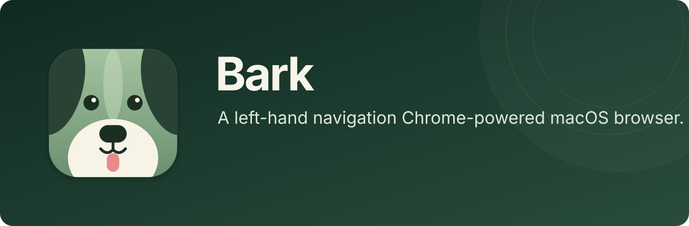

# Bark

[](https://github.com/bendahrooge/bark/stargazers)
[](https://hits.dwyl.com/bendahrooge/bark)

**[Download the latest release](https://github.com/bendahrooge/bark/releases/latest)**

Bark is an Arc-inspired browser built on Chromium, with a native Swift sidebar on macOS.

- Spaces with separate tabs, colors, emoji, and a choice of profile.
- A resizable, collapsible sidebar with pinned tabs, favicons, and light/dark themes.
- Chrome extensions and Incognito windows backed by Chromium's native services.

## Build from source

For macOS, use an Apple Silicon Mac with Xcode and at least **150 GiB free**. Run the preflight before downloading Chromium:

```sh
python3 tools/chromium.py doctor --work-dir /path/to/build-volume
python3 tools/chromium.py verify-patches
python3 tools/chromium.py sync --work-dir /path/to/build-volume
python3 tools/chromium.py build --work-dir /path/to/build-volume --target mac-arm64
```

Launch the development app with `--bark-swift-ui` to enable the sidebar. See the [build guide](engine/chromium/README.md) for prerequisites, packaging, and Linux setup.

## Development

Run the portable checks without building Chromium:

```sh
swift test --scratch-path .build/core
python3 -m unittest discover -s tools/tests
```

[MIT licensed](LICENSE). Chromium and bundled components retain their licenses. Bark is independent of Arc and Google.
